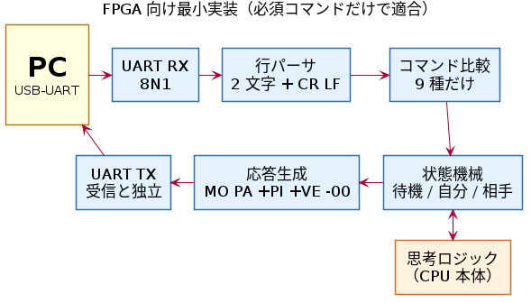

<!-- markdownlint-disable MD025 MD033 -->
<!-- _class: title -->
<!-- _paginate: false -->

# リバーシ UART プロトコル (RUP)

自作 CPU を PC に UART でつないで対局させるための通信仕様

ドラフト v0.2 ／ 2026-05-05

tommie.jp ([@tommie-jp](https://github.com/tommie-jp))

<p class="note">「オセロ」は株式会社メガハウスの登録商標です。本資料では一般名詞の「リバーシ」を使います。</p>

---

## RUP が決めること・決めないこと

<div class="cols">
<div>

- 自作 CPU（FPGA・ディスクリート・MCU）と PC の間を流れる **UART 上のバイト列** だけを決める
- CPU 製作者が **仕様書 1 本で実装できる** ことが目標
- 物理層（変換器・電圧・コネクタ）と PC 側ソフトは範囲外

| レイヤ | 規定 |
| --- | --- |
| メッセージ書式・状態遷移 | ✅ |
| ボーレート・バイト形式 | ✅ |
| 物理層 | ❌ 製作者の領分 |
| PC 側の実装 | ❌ |

</div>
<div>


</div>
</div>

---

<!-- _class: chapter -->

# 1. なぜ UART か

---

## UART なら、どんな自作 CPU にも付けられる

- **回路が小さい**: 送受信とも数十 FF ＋ ボーレートカウンタで済む。ディスクリートでも組める
- **PC 側は市販品で足りる**: USB-UART 変換器を挿せば COM ポートとして見える
- **人間がそのまま読める**: 端末ソフトで `PI` と打てば `+PI` が返る。ロジアナなしで一次デバッグできる
- **速度は製作者が選ぶ**: 9600 / 38400 / 115200 bps。CPU が安定して動く範囲で決めてよい


---

## 書式の選び方も「手打ちで試せる」を優先した

| 決めたこと | 理由 |
| --- | --- |
| ASCII・1 行 1 メッセージ | 端末で読める。パーサが状態を持たない |
| 改行は **CR+LF のみ** | 主要な端末ソフトの既定値で、Enter キーがそのまま送る |
| コマンドは **大文字 2 文字** | 受信バイトを表と直接比べられる。`toupper()` 回路が要らない |
| 座標は **小文字**（`MOd3`） | コマンド（大文字）と見分けやすい。WOF 棋譜の表記と同じ |
| 応答の頭に `+` / `-` | POP3 の `+OK` / `-ERR` に倣った。1 バイトで成功か失敗かわかる |
| `X*` は製作者の拡張領域 | `XA`〜`XZ` の 26 個。公式コマンドは 1 文字目を `A`〜`W` に限る |

<p class="note">CR+LF の代償は「CR を受けたら LF を待つ」1 段の状態追加と、BO が 1 バイト増えること。どちらも数ゲート規模。</p>

---

## 行頭 1 文字で、メッセージの種類が決まる

<div class="cols">
<div>

| 行頭 | 意味 | 例 |
| --- | --- | --- |
| `+` | 直前の送信への成功応答 | `+PI` `+VE02` |
| `-` | 直前の送信へのエラー応答 | `-04 bad coord` |
| なし | 自発通知 | `MOd3` `PA` `RE` |

- **応答が必須なのはクエリだけ**（`PI` `VE` `CA` `X*`）
- 通知（`SB` `MO` など）への応答は任意。PC は `+SB` が来ても捨てる
- CPU は受信内容を **エコーしてはならない**

</div>
<div>

```text
< VE            PC → CPU
> +VE02MyCPU    成功応答

< MOz9          不正な座標
> -04 bad coord エラー応答

< SB            対局開始（通知）
> MOf5          CPU の着手（自発）
```

</div>
</div>

---

<!-- _class: chapter -->

# 2. 最小実装

---

## 必須コマンドだけで仕様に適合する

<div class="cols-wide">
<div>



</div>
<div>

**受信（9 種）**
`SB` `SW` `MO` `PA` `EB` `EW` `ED` `VE` `PI`

**送信**
`MO` `PA` `+PI` `+VE02` `-00`

**状態は 3 つ**
待機 ／ 自分の手番 ／ 相手の手番

</div>
</div>

<p class="note">違反はすべて <code>-00</code> で返すだけで適合。<code>+VE</code> の識別名も省略してよい。</p>

---

## 最小実装のチェックリスト

| 項目 | 値・ルール |
| --- | --- |
| フレーム | 8N1、フロー制御なし |
| RX バッファ | 80 バイト以上を推奨（最長は `BO` の 68 バイト） |
| 文字間タイムアウト | 100 ms。超えたらパーサを戻し、次の `\r\n` まで捨てる |
| 空行 `\r\n` | エラーにせず黙って捨てる |
| 送受信 | 独立（全二重）。`+VE…` を送っている最中も RX を取りこぼさない |
| 盤面の持ち方 | `BO` の並び（行優先 64 文字）以外は自由。ビットボードでもよい |


---

<!-- _class: chapter -->

# 3. 正常フロー

---

## 接続から終局まで

<div class="cols">
<div>

```text
< PI           生存確認
> +PI
< VE           バージョン問い合わせ
> +VE02MyCPU-v1
< SB           あなたは黒・先手
> MOf5         CPU の着手
< MOd6         相手の着手
> MOc3
  ...          手番ごとに交互
< PI           対局中も定期的に
> +PI
  ...
> EN           CPU が投了
```

</div>
<div>

`<` PC → CPU　`>` CPU → PC（`\r\n` は省略）

- **起動検出は PC の `PI` から始める**。CPU は受けて返すだけでよく、電源を入れる順番に左右されない
- `SB` は黒（先手）、`SW` は白（後手）
- 対局中も PC は `PI` を挟んで生存を確かめる。1000 ms で応答がなく、3 回続いたら切断とみなす
- 終局は CPU の `EN`（投了）か、PC の `EB` / `EW` / `ED`

</div>
</div>

---

## CPU 側の状態遷移（例）

<div class="cols-wide">
<div>


</div>
<div>

| 状態 | 役割 |
| --- | --- |
| C0 BOOT | 初期化後に `RE` を送る |
| C1 IDLE | `SB` / `SW` を待つ |
| C2 MY_TURN | 着手を計算して送る |
| C3 WAIT_OPP | 相手の手を待つ |

- `PI` は BOOT 以外のどの状態でも応答
- 終局（`EB` `EW` `ED` `EN`）で C1 に戻る
- 内部の状態表現は自由

</div>
</div>

---

<!-- _class: chapter -->

# 4. 異常系

---

## 仕様違反には `-NN` で返す。自動再送はしない

| コード | 名称 | 例 |
| --- | --- | --- |
| `00` | 汎用 | 理由を特定しない最小実装 |
| `01` | 未知コマンド | `AA`（`X*` は対象外） |
| `02` | 小文字コマンド | `pi` |
| `03` | 改行違反 | `PI\n`、`PI\r` |
| `04` | 座標書式違反 | `MOz9`、`MOD3` |
| `05` | 非合法手 | 置けない場所への `MO` |
| `06` | 状態違反 | 対局中の `SB` など |

- 受け取った側はログに残すだけ。**再送しない**ことで送り合いの無限ループを防ぐ
- `07`〜`29` は予約、`30`〜`99` は CPU ごとに自由に使える

---

## CPU がリセットされたら `RE` で復帰する

<div class="cols-wide">
<div>

```text
（対局中に CPU が電源リセット）
> RE        起動完了・再送して
< MOd5      PC が直前の指示を再送
> MOd7      CPU が着手
  ...
```

- CPU が自分から送るのは起動直後の `RE` だけ
- PC は `RE` を受けたら **直前に送った指示**（`SB`・`MO`・`BO` など）を送り直す
- 24 時間動かすボット運用で役に立つ

</div>
<div>


</div>
</div>

---

## 盤面がずれたら `RS` で同期し直す

```text
（PC から来た MOb5 が、CPU の盤面では置けない手だった）
> RS          盤面を送り直して
< BO0000...   PC が現在の局面（64 文字）を送る
< MOb5        続けて直前の指示を再送
> MOd7        CPU は盤面を上書きしてから着手
```

- 盤面を自分で持つ CPU 向けの任意機能。PC のバグやビット化けから自力で戻れる
- 毎手 `BO` で盤面をもらう実装なら不要
- `RS` が続くときは、PC が 3 回程度で打ち切って対局を止めてよい

---

<!-- _class: chapter -->

# 5. v0.2 → v0.3 で決めたいこと

---

## 未確定の挙動（ご意見ください）

**合法手があるのに CPU が `PA` を返したら**

- 案 A: そのままパス扱い ／ 案 B: `-05` を返す ／ 案 C: PC が無視して再度手番を渡す

**相手パス通知 `PA` は「合法手がないとき」だけか**、自主パスも含むか

**対局中（C2 / C3）に `SB` / `SW` が来たら**

- 案 A: 今の対局を捨てて新しく始める ／ 案 B: 無視する

**自分の手番（C2）に相手の `PA` が来たら**: 黙って捨てるか、`-06` を返すか

---

## FPGA 実装者のための明文化候補

| 候補 | 内容 | 優先度 |
| --- | --- | --- |
| D | `NC<nodes>,<ms>` は FPGA では省略推奨と明記（10 進変換が重い） | 中 |
| E | `ST<text>` を最大 64 文字・ASCII 印字可能文字に制限 | 中 |
| F | 許す文字を 0x20–0x7E と CR+LF に限定。それ以外は違反 | 中 |
| G〜J | LSB first、全二重、「1 受信に 1 応答を順番に返す」などを明記 | 低 |

**変えないと決めたもの**: `BO` の短縮形、座標のバイナリ化、ボーレート固定

---

<!-- _class: title -->

## フィードバック募集中

<div class="cols-wide">
<div>

仕様書・図・検討資料はすべて GitHub にあります

**[github.com/tommie-jp/reversi-uart-protocol](https://github.com/tommie-jp/reversi-uart-protocol)**

- `README.ja.md` ／ `README.md` — 仕様本文（日本語 ／ 英語）
- `doc/検討事項.md` — 未確定の項目
- `doc/設計レビュー.md` — 4 つの立場からのレビュー

Issue・PR・実装報告をお待ちしています

</div>
<div style="text-align: center;">


<p class="note">GitHub リポジトリ</p>

</div>
</div>
